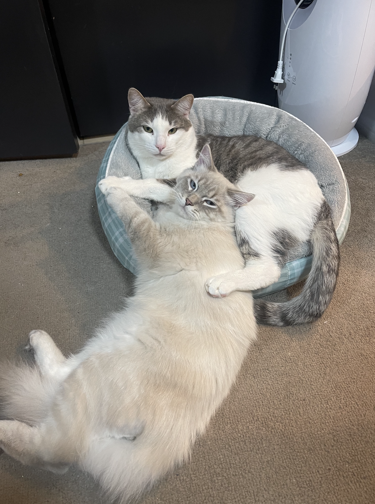
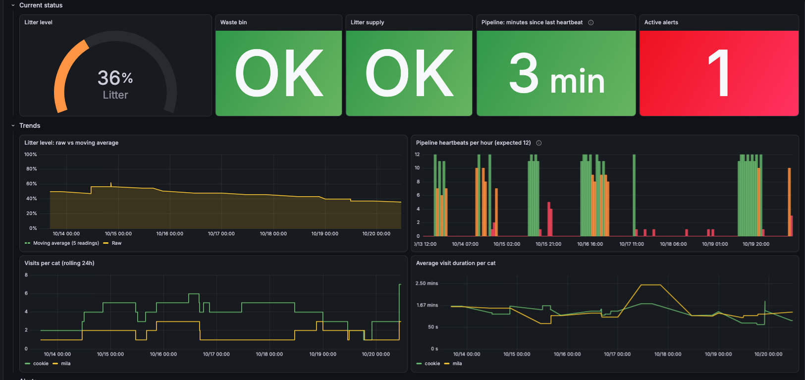
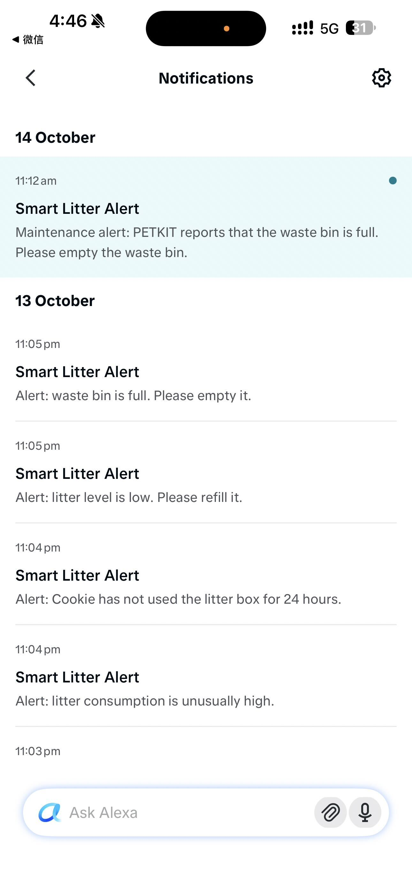

# Smart Litter Monitor

Cookie and Mila share a PetKit Pura X smart litter box. The PetKit app tells you when something is wrong — but only if you open it. This system monitors the litter box continuously, calculates health alerts from raw sensor data, and pushes them to an Alexa Echo and my phone automatically.




## Dashboard



Live view of litter level, waste bin status, per-cat visit rates and durations, pipeline heartbeats, and active alerts — updated every 5 minutes.

## Alerts

When something needs attention, Alexa announces it on the Echo device and sends a push notification to the Alexa app:



| Alert | Rule |
|---|---|
| No visit | A tracked cat has no litter-box visit in the latest 24-hour window |
| Fast litter consumption | Current 24-hour consumption is more than 10% above the preceding 7-day baseline |
| Low litter | PetKit reports that litter is low |
| Waste box full | PetKit reports that the waste box is full |

Alerts are deduplicated and suppressed during quiet hours. The rules are deterministic — no AI required for these signals.

## How it works


| Component | Role |
|---|---|
| **Python collector** | Pulls PetKit API every 5 min, calculates 7 sensor streams and 4 alert rules, publishes to MQTT |
| **Mosquitto** | Local MQTT broker |
| **Node-RED** | Validates readings, applies a 5-point moving average, deduplicates alerts, enforces quiet hours, routes to Alexa and InfluxDB |
| **InfluxDB** | Time-series storage for all sensor readings, alerts, and heartbeats |
| **Grafana** | Live dashboard provisioned from code |
| **AWS IoT Core** | Receives structured sensor data and alerts over TLS for cloud-side processing |

### Node-RED flow


One flow handles everything: MQTT ingestion → sensor validation → smoothing → InfluxDB writes → alert routing → Alexa announcements → AWS IoT Core publishing.

### AWS IoT Core


Node-RED publishes structured JSON to `cps/sensor/data` and `cps/alerts/#` over MQTT with TLS (port 8883) using X.509 device certificates.

## Sensor streams

| Topic | Description |
|---|---|
| `litter/sensor/sand_percent` | Litter level (0–100%) |
| `litter/sensor/box_full` | Waste bin full status |
| `litter/sensor/sand_lack` | Litter low warning |
| `litter/sensor/cookie/visit_rate` | Cookie's visits per 24h |
| `litter/sensor/mila/visit_rate` | Mila's visits per 24h |
| `litter/sensor/cookie/avg_duration` | Cookie's average visit duration (s) |
| `litter/sensor/mila/avg_duration` | Mila's average visit duration (s) |

## Getting started

The whole stack runs in containers — no local Python, Mosquitto, or Node-RED install needed. These steps use [Finch](https://github.com/runfinch/finch); Docker Desktop works the same with `docker compose` in place of `finch compose`.

### 1. Install Finch (one time)

```bash
brew install --cask finch
finch vm init
```

If a local Mosquitto or Node-RED is already running, stop it first — the containers need ports 1883 and 1880.

### 2. Clone and configure

```bash
git clone https://github.com/cilari/smart-litter-monitor.git
cd smart-litter-monitor
cp .env.example .env
```

Fill in the PetKit credentials and other values in `.env` (never committed).

### 3. Start the stack

```bash
finch compose up -d --build
finch compose ps
```

The first run downloads images and takes a few minutes. All services should show `running`:

| Service | Purpose | URL |
|---|---|---|
| `collector` | Runs `export_petkit_csv.py` every 5 minutes | — |
| `mosquitto` | MQTT broker | `localhost:1883` |
| `node-red` | Validation, alerts, InfluxDB writes, Alexa | http://localhost:1880 |
| `influxdb` | Time-series storage | http://localhost:8086 |
| `grafana` | Dashboard | http://localhost:3000 |

### 4. One-time Node-RED setup

Credentials are stored outside the repository, so enter them once in Node-RED:

1. Open http://localhost:1880
2. Double-click **Store smart-litter points**, click the pencil next to **Server**, and set the token to the `INFLUXDB_TOKEN` value from `.env`
3. Configure your Alexa account and Echo device in the announcement node, then select the same account in **Push alert to Alexa app**
4. Click **Deploy**

Node-RED encrypts these with `NODE_RED_CREDENTIAL_SECRET`, so they persist across restarts.

### Daily use

| Action | Command |
|---|---|
| Start | `finch vm start` then `finch compose up -d` |
| Stop | `finch compose down` |
| Collector logs | `finch logs -f slm-collector` |
| Run one collection now | `finch exec slm-collector python python/export_petkit_csv.py --publish-architecture` |

## Project structure

```
smart-litter-monitor/
├── .github/workflows/   CI — lint + tests on every push
├── python/              PetKit data collection and alert rules
├── tests/               Unit tests for alert logic
├── node-red/            Flow export, image with required nodes, settings
├── grafana/             Datasource and dashboard provisioning
├── mosquitto/           MQTT broker config
├── aws/                 IoT Core policy and certificate setup
├── Dockerfile           Collector image
├── docker-compose.yml   Full stack
└── requirements.txt     Python dependencies
```
