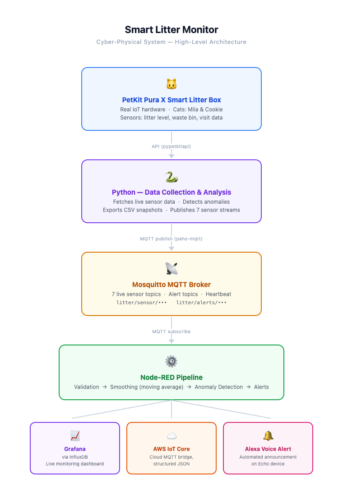

# Smart Litter Monitor

A real-time Cyber-Physical System that monitors a PetKit Pura X smart litter box, detects changing health patterns per cat, and sends automated alerts via Alexa, Grafana, and AWS IoT Core.



## How it works

- **Python** fetches live sensor data from the PetKit API every 5 minutes and publishes 7 sensor streams to MQTT
- **Mosquitto** brokers all MQTT messages locally
- **Node-RED** validates, smooths, and runs anomaly detection on incoming data
- **InfluxDB + Grafana** stores time-series data and renders a live monitoring dashboard
- **AWS IoT Core** receives all sensor data over TLS for cloud integration
- **Alexa** announces urgent alerts via an Echo device

## Sensor streams

| Topic | Description |
|---|---|
| `litter/sensor/sand_percent` | Litter level (0–100%) |
| `litter/sensor/box_full` | Waste bin full status |
| `litter/sensor/sand_lack` | Litter low warning |
| `litter/sensor/cookie/visit_rate` | Cookie's visits per 24h |
| `litter/sensor/mila/visit_rate` | Mila's visits per 24h |
| `litter/sensor/cookie/avg_duration` | Cookie's average visit duration (s) |
| `litter/sensor/mila/avg_duration` | Mila's average visit duration (s) |

## Getting started

```bash
# 1. Clone the repo
git clone https://github.com/cilari/smart-litter-monitor.git
cd smart-litter-monitor

# 2. Set up environment
cp .env.example .env
# Fill in your PetKit credentials and config in .env

# 3. Install Python dependencies
pip install -r requirements.txt

# 4. Start the full stack
docker compose up -d
```

## Project structure

```
smart-litter-monitor/
├── .github/workflows/   CI/CD — lint + tests on every push
├── python/              Data collection, alert rules
├── tests/               Unit tests for alert logic
├── node-red/            Node-RED flow export (flows.json)
├── grafana/             Dashboard config
├── mosquitto/           MQTT broker config
├── aws/                 IoT Core policy
└── docker-compose.yml   One-command stack start
```

## CI status


